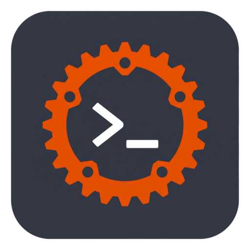
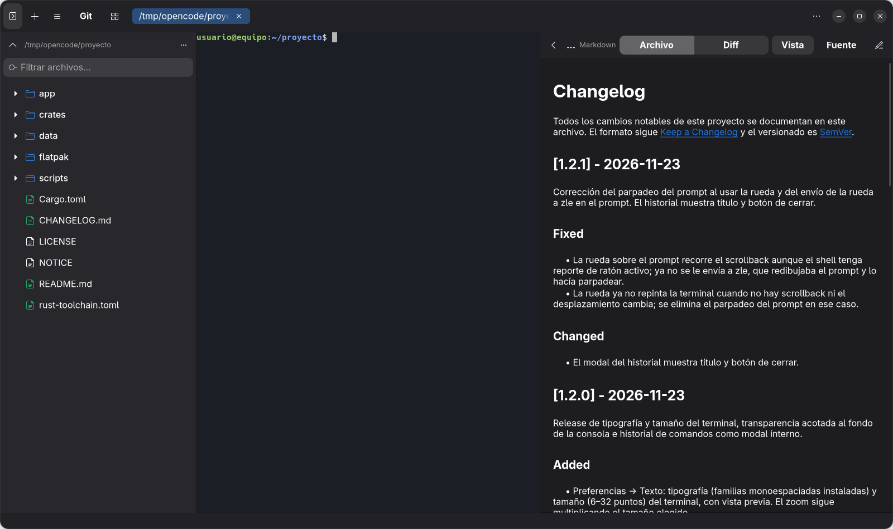
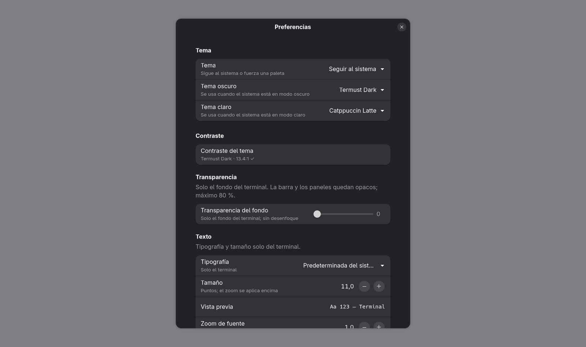
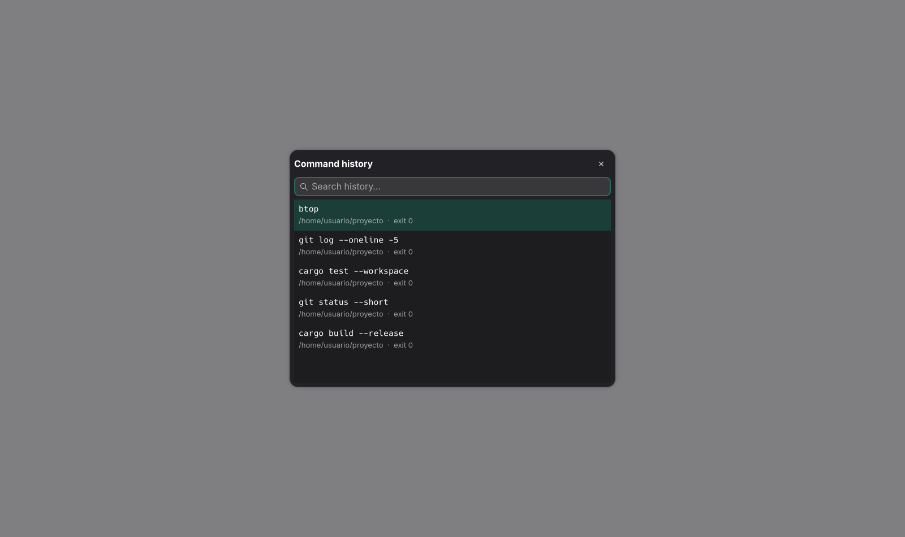

<p align="center">
  
</p>

<h1 align="center">Termust</h1>

<p align="center">
  A terminal for GNOME written in Rust with GTK4 and libadwaita.
</p>

<p align="center">
  <strong>English</strong> · <a href="README.md">Español</a>
</p>

<p align="center">
  
  
  
  
</p>

Termust is a terminal for GNOME built for everyday use: tabs and panes, a file
tree, a code viewer, rendered Markdown, local and remote git, command history,
themes, configurable typography, and agent detection.

The interface is available in English and Spanish. It follows the system
language and can be changed in Preferences → General; restart to apply.

## Screenshots



*Terminal with the file tree, the file column, and the rendered Markdown view.*



*Preferences: theme, contrast, transparency, and terminal typography.*



*Command history as an internal modal: search, arrows, Enter, and Esc.*

## Features

### Terminal

- VT emulator built on `alacritty_terminal`: 256 colors and truecolor,
  scrollback, selection, clipboard, bracketed paste, and mouse reporting.
- bash and zsh integration through OSC 7/133/633 without touching your
  dotfiles: cwd, prompt/command marks, and tab title.
- Configurable monospace font (family and size from 6 to 32 pt) with
  independent zoom (`Ctrl +`, `Ctrl -`, `Ctrl 0`).
- Optional transparency for the terminal background only (up to 80%); the
  header bar, panels, and text stay opaque.

### Tabs and panes

- Horizontal or vertical tabs, renameable and with their own theme.
- Up to four panes per tab with draggable dividers.
- Session restore: tabs, panes, ratios, directories, and focus.
- Confirmation when closing a tab or the window with running processes.

### Files and viewer

- Lazy file tree with search, optional hidden files, and tracking of the active
  pane's cwd.
- Read-only viewer with tree-sitter for 14 languages: highlighting, line
  numbers, folds, outline, and search.
- File column to the right of the terminal, with `File | Diff` and the git diff
  of the open file (working tree or index).
- Markdown as a document: headings, lists, quotes, code blocks, tables, local
  images, and clickable links, with a `View | Source` toggle.
- Open the file in an external editor from the viewer.

### Git

- Local panel: status, stage/unstage, diff, commit, and binary detection.
- SSH/HTTPS remotes, encrypted credentials, and a vault with its key in Secret
  Service.
- Never force-pushes.

### History and agents

- zsh/bash command history imported in the background, with search and
  reloading the command at the prompt.
- Detection of `opencode`, `pi`, and `agy`: name, task, and status in a
  dedicated bar.

### Appearance and accessibility

- 37 bundled palettes, themes importable from `~/.config/termust/themes`,
  automatic light/dark mode, and computed contrast.
- Adwaita preferences (theme, transparency, typography, zoom) and documented
  shortcuts.
- Spanish/English i18n on the main surface, accessibility labels, and HIG
  dialogs (About, Shortcuts, Overview).

## Installation

### Flatpak (bundle)

Download `termust-1.3.0.flatpak` from the releases page and run:

```sh
flatpak install --user ./termust-1.3.0.flatpak
flatpak run io.github.gac982.Termust
```

### Flatpak from the signed repo

```sh
gpg --import termust-release-key.asc
flatpak remote-add --user --if-not-exists \
  --gpg-import=termust-release-key.asc termust \
  "file://$PWD/dist/repo"
flatpak install --user termust io.github.gac982.Termust
```

The bundle is not signed itself: verification is done by the repo (`summary`
signed with the release key).

### From source

Requirements: Linux with GNOME/Wayland (X11 works as a fallback), GTK 4.22,
libadwaita 1.9, Rust 1.100 (MSRV 1.92), and Flatpak for packaging.

```sh
cargo build --release -p termust-app
cargo test --workspace
./scripts/ci/verify.sh
```

To build the Flatpak locally:

```sh
./scripts/flatpak-src.sh
flatpak-builder --user --install --force-clean build-dir flatpak/io.github.gac982.Termust.yml
flatpak run io.github.gac982.Termust
```

## Usage

| Shortcut | Action |
| --- | --- |
| `F9` | Show or hide the file tree |
| `Ctrl Shift T` | New tab |
| `Ctrl Shift W` | Close tab |
| `Ctrl Shift D` | Split the pane to the right |
| `Ctrl Shift E` | Split the pane below |
| `Ctrl Shift L` | Vertical tabs |
| `Ctrl Shift G` | Git panel |
| `Ctrl ,` | Preferences |
| `Ctrl ?` | Keyboard shortcuts |
| `Ctrl +` / `Ctrl -` / `Ctrl 0` | Terminal font zoom |
| `↑` (empty prompt) | Command history |
| `Esc` | Close the visible overlay |

Open a `.md` file from the tree to view it as a document; the `Source` button
returns to the original Markdown and the pencil opens it in the external
editor.

## Architecture

| Crate | Responsibility |
| --- | --- |
| `termust-core` | Terminal model, themes, keymap, history, mouse |
| `termust-term-engine` | VT on `alacritty_terminal` and OSC |
| `termust-ui` | GTK terminal widget, drawing, input, and accessibility |
| `termust-render-cairo` | Grid and text rendering |
| `termust-text-render` | Metrics, fonts, and text themes |
| `termust-pty-unix` | PTY and host shell |
| `termust-host-exec` | Host execution from Flatpak |
| `termust-store` | Atomic session and preferences |
| `termust-git-local` / `termust-git-remote` | Local git and remotes |
| `termust-vault` | Encrypted credentials |
| `termust-agents` | Agent detection |
| `termust-syntax` | tree-sitter: highlighting, folds, and outline |
| `termust-fs-local` | File tree |
| `termust-app` | Window, tabs, panes, and preferences |

## Development

```sh
./scripts/ci/verify.sh   # fmt, clippy, architecture, and tests
./scripts/repro-check.sh # two release builds with the same SHA-256
./scripts/release.sh     # Flatpak, SBOM, NOTICE, repo, and bundle
```

Regression hooks (enabled with environment variables and `--no-restore`):
`TERMUST_VIEWER_TEST`, `TERMUST_MARKDOWN_TEST`, `TERMUST_FILECOLUMN_TEST`,
`TERMUST_DIFFVIEW_TEST`, `TERMUST_POINTER_TEST`, `TERMUST_HISTORY_TEST`,
`TERMUST_PREFS_TEST`, `TERMUST_THEME_TEST`, `TERMUST_WORKAREA_TEST`,
`TERMUST_RESIZE_TEST`, and `TERMUST_EXIT_TEST`.

The release signs the git tag and the Flatpak repo with `GPG_KEY`; artifacts
are published in `dist/` (`termust-<version>.flatpak`, CycloneDX SBOM,
`SHA256SUMS`, local repo).

## Security and privacy

- No telemetry. The shell runs on the host; the Flatpak uses
  `--filesystem=host` for files/git and `flatpak-spawn` wrapped in
  `host-exec`.
- HTTPS credentials encrypted in SQLite; master key in Secret Service.
- SSH uses the host's `git`/`ssh` and never reads private keys.
- The viewer is read-only: it does not write files.

## License

GPL-3.0-or-later. See `LICENSE` and `NOTICE`.
