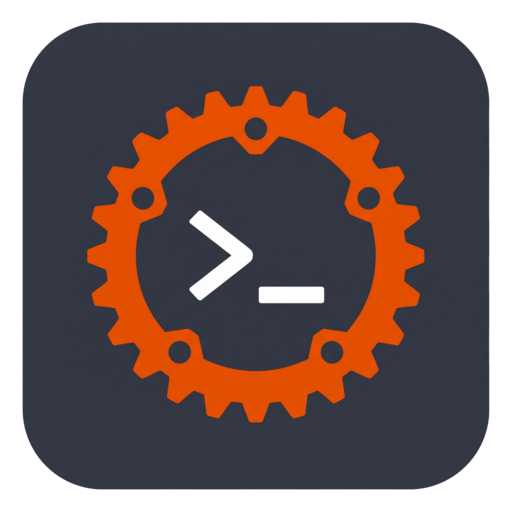
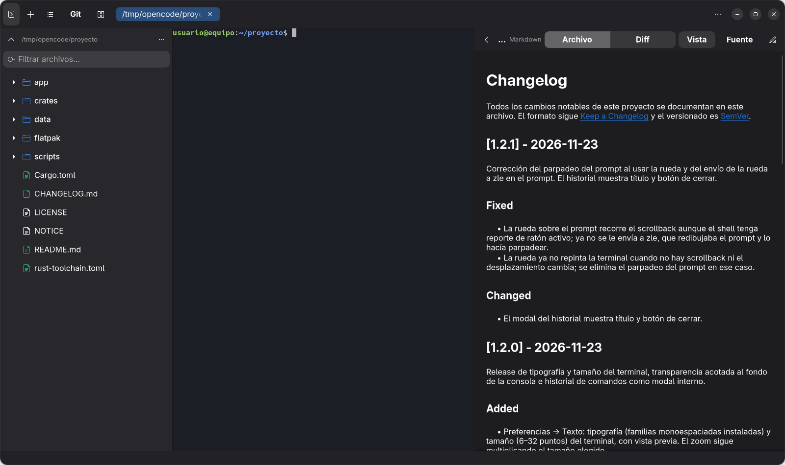
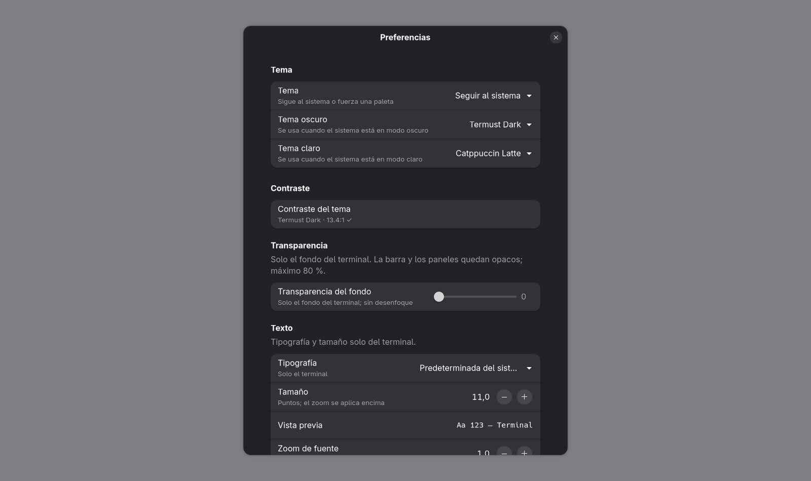
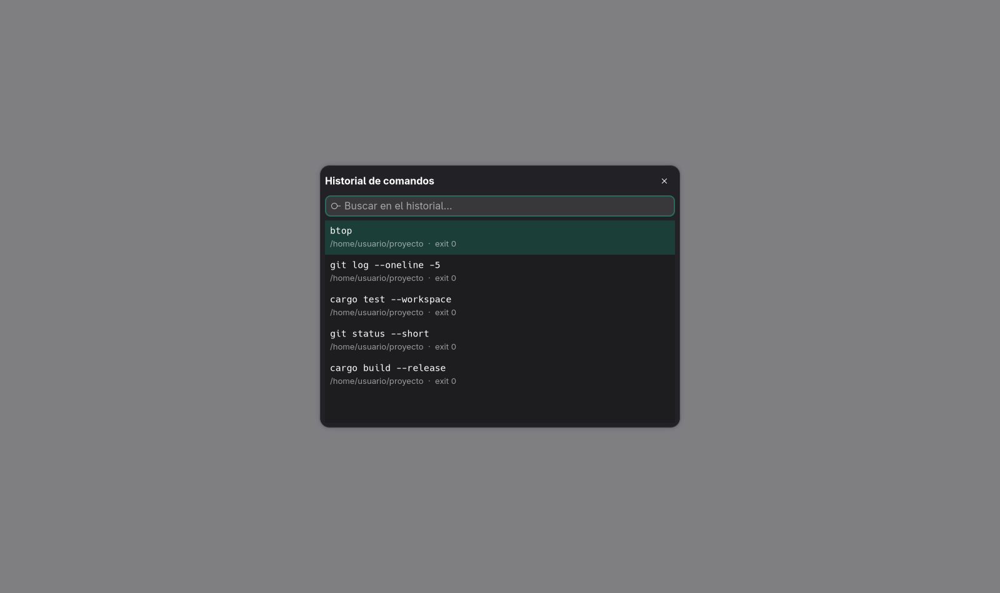

<p align="center">
  
</p>

<h1 align="center">Termust</h1>

<p align="center">
  Terminal para GNOME escrita en Rust con GTK4 y libadwaita.
</p>

<p align="center">
  
  
  
  
</p>

Termust es una terminal para GNOME pensada para el uso diario: pestañas y
paneles, árbol de archivos, visor de código, vista renderizada de Markdown,
git local y remoto, historial de comandos, temas, tipografía configurable y
detección de agentes.

## Capturas



*Terminal con el árbol de archivos, la columna de archivos y la vista
renderizada de Markdown.*



*Preferencias: tema, contraste, transparencia y tipografía del terminal.*



*Historial de comandos como modal interno: búsqueda, flechas, Enter y Esc.*

## Funciones

### Terminal

- Emulador VT sobre `alacritty_terminal`: 256 colores y truecolor, scrollback,
  selección, portapapeles, bracketed paste y reporte de ratón.
- Integración con bash y zsh mediante OSC 7/133/633 sin tocar tus dotfiles:
  cwd, marcas de prompt/comando y título de la pestaña.
- Fuente monoespaciada configurable (familia y tamaño de 6 a 32 pt) con zoom
  independiente (`Ctrl +`, `Ctrl -`, `Ctrl 0`).
- Transparencia opcional solo del fondo del terminal (máximo 80 %); la barra
  superior, los paneles y el texto quedan opacos.

### Pestañas y paneles

- Pestañas horizontales o verticales, renombrables y con tema propio.
- Hasta cuatro paneles por pestaña con divisores arrastrables.
- Restauración de sesión: pestañas, paneles, proporciones, directorios y foco.
- Confirmación al cerrar una pestaña o la ventana con procesos activos.

### Archivos y visor

- Árbol de archivos lazy con búsqueda, ocultos opcionales y seguimiento del cwd
  del panel activo.
- Visor de solo lectura con tree-sitter para 14 lenguajes: resaltado, números,
  folds, esquema y búsqueda.
- Columna de archivos a la derecha del terminal, con `Archivo | Diff` y el diff
  de git del archivo abierto (working tree o index).
- Markdown como documento: títulos, listas, citas, bloques de código, tablas,
  imágenes locales y links clickeables, con toggle `Vista | Fuente`.
- Abrir el archivo en el editor externo desde el visor.

### Git

- Panel local: status, stage/unstage, diff, commit y detección de binarios.
- Remotos SSH/HTTPS, credenciales cifradas y vault con clave en Secret Service.
- Nunca hace force push.

### Historial y agentes

- Historial de comandos de zsh/bash importado en segundo plano, con búsqueda y
  recarga del comando en el prompt.
- Detección de `opencode`, `pi` y `agy`: nombre, tarea y estado en una barra
  dedicada.

### Apariencia y accesibilidad

- 37 paletas incluidas, temas importables desde `~/.config/termust/themes`,
  modo automático claro/oscuro y contraste calculado.
- Preferencias Adwaita (tema, transparencia, tipografía, zoom) y atajos
  documentados.
- i18n español/inglés en la superficie principal, etiquetas de accesibilidad y
  diálogos HIG (Acerca de, Atajos, Vista general).

## Instalación

### Flatpak (bundle)

Descargá `termust-1.2.0.flatpak` desde la página de releases y ejecutá:

```sh
flatpak install --user ./termust-1.2.0.flatpak
flatpak run io.github.termust.Termost
```

### Flatpak desde el repo firmado

```sh
gpg --import termust-release-key.asc
flatpak remote-add --user --if-not-exists \
  --gpg-import=termust-release-key.asc termust \
  "file://$PWD/dist/repo"
flatpak install --user termust io.github.termust.Termost
```

El bundle no lleva firma propia: la verificación la hace el repo (`summary`
firmado con la clave de release).

### Desde el código

Requisitos: Linux con GNOME/Wayland (X11 funciona como fallback), GTK 4.22,
libadwaita 1.9, Rust 1.100 (MSRV 1.92) y Flatpak para empaquetar.

```sh
cargo build --release -p termust-app
cargo test --workspace
./scripts/ci/verify.sh
```

Para generar el Flatpak local:

```sh
./scripts/flatpak-src.sh
flatpak-builder --user --install --force-clean build-dir flatpak/io.github.termust.Termost.yml
flatpak run io.github.termust.Termost
```

## Uso

| Atajo | Acción |
| --- | --- |
| `F9` | Mostrar u ocultar el árbol de archivos |
| `Ctrl Shift T` | Nueva pestaña |
| `Ctrl Shift W` | Cerrar pestaña |
| `Ctrl Shift D` | Dividir el panel a la derecha |
| `Ctrl Shift E` | Dividir el panel abajo |
| `Ctrl Shift L` | Pestañas verticales |
| `Ctrl Shift G` | Panel de git |
| `Ctrl ,` | Preferencias |
| `Ctrl ?` | Atajos de teclado |
| `Ctrl +` / `Ctrl -` / `Ctrl 0` | Zoom de la fuente del terminal |
| `↑` (prompt vacío) | Historial de comandos |
| `Esc` | Cerrar el overlay visible |

Abrí un `.md` desde el árbol para verlo como documento; el botón `Fuente`
vuelve al Markdown original y el lápiz lo abre en el editor externo.

## Arquitectura

| Crate | Responsabilidad |
| --- | --- |
| `termust-core` | Modelo del terminal, temas, keymap, historial, mouse |
| `termust-term-engine` | VT sobre `alacritty_terminal` y OSC |
| `termust-ui` | Widget GTK del terminal, dibujo, entrada y accesibilidad |
| `termust-render-cairo` | Render de la grilla y del texto |
| `termust-text-render` | Métricas, fuentes y temas de texto |
| `termust-pty-unix` | PTY y shell del host |
| `termust-host-exec` | Ejecución en el host desde Flatpak |
| `termust-store` | Sesión atómica y preferencias |
| `termust-git-local` / `termust-git-remote` | Git local y remotos |
| `termust-vault` | Credenciales cifradas |
| `termust-agents` | Detección de agentes |
| `termust-syntax` | tree-sitter: resaltado, folds y esquema |
| `termust-fs-local` | Árbol de archivos |
| `termust-app` | Ventana, pestañas, paneles y preferencias |

## Desarrollo

```sh
./scripts/ci/verify.sh   # fmt, clippy, arquitectura y tests
./scripts/repro-check.sh # dos builds release con el mismo SHA-256
./scripts/release.sh     # Flatpak, SBOM, NOTICE, repo y bundle
```

Hooks de regresión (se activan con variables de entorno y `--no-restore`):
`TERMUST_VIEWER_TEST`, `TERMUST_MARKDOWN_TEST`, `TERMUST_FILECOLUMN_TEST`,
`TERMUST_DIFFVIEW_TEST`, `TERMUST_POINTER_TEST`, `TERMUST_HISTORY_TEST`,
`TERMUST_PREFS_TEST`, `TERMUST_THEME_TEST`, `TERMUST_WORKAREA_TEST`,
`TERMUST_RESIZE_TEST` y `TERMUST_EXIT_TEST`.

El release firma el tag de git y el repo Flatpak con `GPG_KEY`; los artefactos
se publican en `dist/` (`termust-<versión>.flatpak`, SBOM CycloneDX,
`SHA256SUMS`, repo local).

## Seguridad y privacidad

- Sin telemetría. El shell corre en el host; el Flatpak usa `--filesystem=host`
  para archivos/git y `flatpak-spawn` encapsulado en `host-exec`.
- Credenciales HTTPS cifradas en SQLite; clave maestra en Secret Service.
- SSH usa el `git`/`ssh` del host y nunca lee claves privadas.
- El visor es de solo lectura: no escribe archivos.

## Estado

Versión **1.2.0**. Tag y repo Flatpak firmados con la clave de release.
GitHub y Flathub están en preparación; el repo propio queda como canal de
distribución mientras tanto.

## Licencia

GPL-3.0-or-later. Ver `LICENSE` y `NOTICE`.
